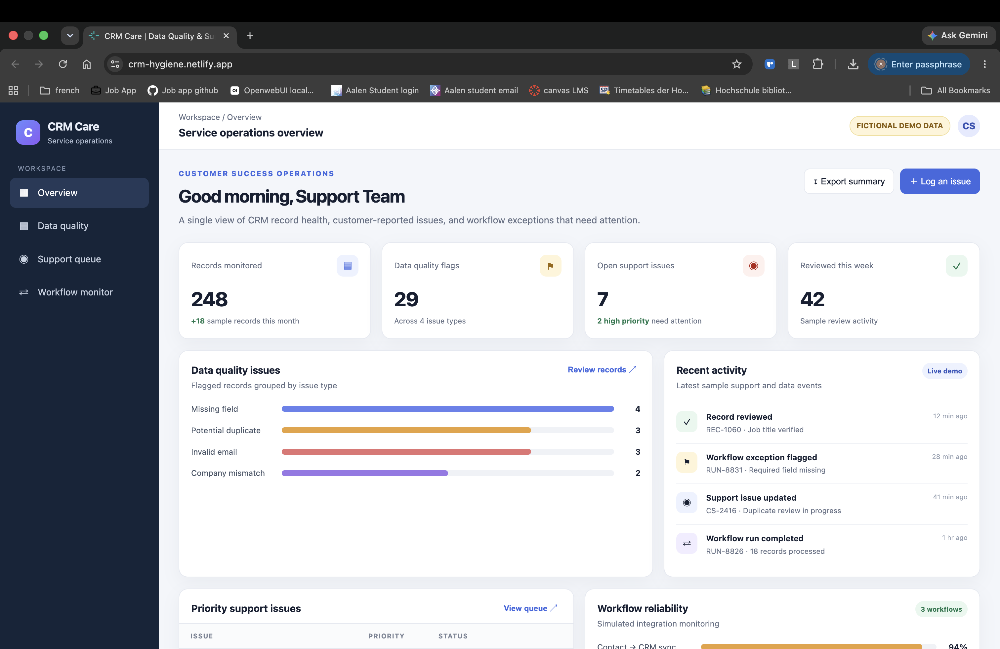

# CRM Care: Data Quality & Support Operations

**Live demo:** https://crm-hygiene.netlify.app/

## Overview

CRM Care is an independent portfolio project inspired by challenges in customer success operations, CRM data maintenance, and workflow troubleshooting.

CRM records can become inconsistent over time due to missing information, invalid email addresses, potential duplicates, and inconsistent company details. Support teams also need a structured way to document customer-reported issues, investigate problems, and track resolutions.

This project demonstrates a lightweight interface for reviewing data-quality issues and organising support operations.

## Preview

**Live demo:** https://crm-hygiene.netlify.app/

## Features

- **Data quality review:** Identify missing fields, invalid email addresses, potential duplicate records, and inconsistent company information.
- **Support issue tracking:** Organise issues by priority, status, ownership, and troubleshooting notes.
- **Workflow monitoring demo:** Explore simulated workflow runs and example failure scenarios.
- **Operational reporting:** View summary metrics and export relevant data where supported.

## Technology

- HTML
- CSS
- JavaScript
- CSV-based data export

## Demo data and limitations

This is a front-end portfolio prototype using fictional sample data. It is not connected to a live CRM, customer database, Zapier, or Workato account. Workflow events are simulated for demonstration purposes.

The project is intended to illustrate support processes and data-quality concepts, not to replace a production CRM or helpdesk platform.

## Background

The project draws on my experience in customer success, software issue investigation, workflow automation, and CRM data hygiene. It explores how these practices can be organised into a repeatable support process.

## Author

Amith A.R.
